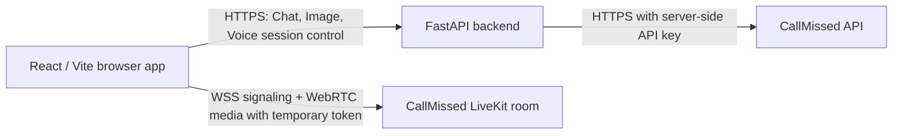

# AI Interaction Platform

A small AI workspace with Chat, Image generation, and a real-time Voice agent. The React frontend talks to a FastAPI backend for all CallMissed API requests. During a voice session, the browser connects to the temporary LiveKit endpoint returned by the backend.

## Features

- **Chat:** Send a message, read the AI reply, and retry a failed request. The conversation stays in browser memory.
- **Image generation:** Submit a prompt and display the generated image, with progress, error, retry, and regenerate states.
- **Voice agent:** Start and end a live conversation, publish microphone audio, play the agent's audio, and show connection and speaking states. Session cleanup runs on End, connection failure, or leaving the Voice workspace.
- **Responsive workspace:** Desktop sidebar becomes compact navigation on smaller screens. Controls have labels, visible focus, and text status.

## Screenshots

Screenshots can be added here after deployment: desktop workspace, mobile workspace, and an active Voice session.

## Architecture



**Request flows**

1. **Chat:** Browser posts a message to `/api/v1/chat`; FastAPI calls CallMissed and returns the assistant text.
2. **Image:** Browser posts a prompt to `/api/v1/images/generate`; FastAPI validates the provider image and returns an `image_data_url` for display.
3. **Voice:** Browser creates a session through FastAPI, receives `session_id`, `ws_url`, and a temporary token, then connects to LiveKit over `wss://`. LiveKit carries microphone and agent audio over WebRTC. On End or workspace exit, the browser stops the mic, disconnects the room, and asks FastAPI to delete the provider session. The permanent API key never enters the browser.

The backend does not proxy live audio. Voice `processing` is a UI inference from transcription, not a provider status.

## Tech stack

| Layer | Technology |
| --- | --- |
| Frontend | React 19, Vite 8, CSS, `livekit-client` |
| Backend | Python, FastAPI, Pydantic Settings, HTTPX, Uvicorn |
| Tests | Vitest, Testing Library, Pytest |
| External service | CallMissed Chat, Image, and Voice APIs |

## Project structure

```text
backend/
  app/api/          Chat, Image, and Voice routes
  app/core/         Settings and safe error responses
  app/schemas/      Request and response validation
  app/services/     CallMissed HTTP integration
  tests/            Backend tests
  .env.example      Backend configuration template
frontend/
  src/features/     Chat, Image, and Voice UI
  src/services/     Backend API client
  src/styles.css    Responsive styles
  .env.example      Public frontend configuration template
  package-lock.json
```

## Local setup

Use Python 3.14 (the tested version) and Node.js 22.22 or newer. A CallMissed API key is needed for live requests. Keep local `.env` files out of Git.

Create `backend/.env` from `backend/.env.example` and set `CALLMISSED_API_KEY`. The other CallMissed settings have defaults. `CORS_ORIGINS` is a JSON array of exact origins; the example permits only the two local Vite origins.

In a terminal at the repository root:

```sh
python -m venv .venv
```

Activate the virtual environment using your shell, then install dependencies and run FastAPI:

```sh
cd backend
python -m pip install -r requirements-dev.txt
python -m uvicorn app.main:app --host 127.0.0.1 --port 8000
```

In a second terminal:

```sh
cd frontend
npm ci
npm run dev
```

Open `http://127.0.0.1:5173`. The Vite development server proxies `/api` and `/health` to `http://127.0.0.1:8000`. Local Voice needs microphone permission and a secure browser context; loopback origins are treated as secure by current browsers. The FastAPI health check is at `http://127.0.0.1:8000/health`.

### Environment variables

| Service | Variable | Purpose |
| --- | --- | --- |
| Backend | `CALLMISSED_API_KEY` | **Required secret.** Set only in the backend environment. |
| Backend | `CORS_ORIGINS` | JSON array of exact allowed frontend origins. Set to the deployed site origin in production. |
| Backend | `CALLMISSED_BASE_URL`, `CALLMISSED_CHAT_MODEL`, `CALLMISSED_IMAGE_MODEL`, `CALLMISSED_IMAGE_SIZE` | Optional provider settings; see `backend/.env.example`. |
| Backend | `CALLMISSED_VOICE_SYSTEM_PROMPT`, `CALLMISSED_VOICE`, `CALLMISSED_VOICE_LANGUAGE`, `CALLMISSED_VOICE_MAX_DURATION_SECONDS` | Optional voice settings; see `backend/.env.example`. |
| Frontend | `VITE_API_BASE_URL` | Public HTTPS origin of the deployed FastAPI backend, without a trailing slash. Leave empty for the local Vite proxy. |

Anything prefixed `VITE_` is embedded in the frontend build. Never put the CallMissed key or a Voice token in a `VITE_` variable. Changing `VITE_API_BASE_URL` requires a frontend rebuild.

## Testing

From `backend`, with the virtual environment active:

```sh
python -m pytest -q
```

From `frontend`:

```sh
npm test
npm run build
```

The automated tests cover backend contracts and failure handling, frontend Chat and Image states, API error translation, and Voice start, cleanup, and microphone-denied paths. A real voice conversation must also be checked in a browser with a microphone and speakers.

## API endpoints

| Method | Path | Purpose |
| --- | --- | --- |
| GET | `/health` | Health check |
| POST | `/api/v1/chat` | Chat message → AI response |
| POST | `/api/v1/images/generate` | Image prompt → displayable data URL |
| POST | `/api/v1/voice/sessions` | Create temporary Voice session |
| DELETE | `/api/v1/voice/sessions/{session_id}` | Terminate Voice session |

Request and response shapes are defined in `backend/app/schemas`. FastAPI also exposes interactive API documentation at `/docs`.

## Deployment on Render

Use a Render **Web Service** for FastAPI and a Render **Static Site** for Vite. Both receive public HTTPS URLs and managed TLS. These are dashboard settings; no Dockerfile or hosting manifest is needed. Create the backend first so its URL can be used in the frontend build.

1. Push the repository to your Git host. In Render, create a **Web Service** from this repository. Set **Root Directory** to `backend`, **Language** to Python, **Build Command** to `pip install -r requirements.txt`, **Start Command** to `uvicorn app.main:app --host 0.0.0.0 --port $PORT`, and **Health Check Path** to `/health`. Choose the Free instance for an assignment demo. Set `CALLMISSED_API_KEY` in Render's backend environment. Optionally pin `PYTHON_VERSION=3.14.3`.
2. Create a **Static Site** from the same repository. Set **Root Directory** to `frontend`, **Build Command** to `npm ci && npm run build`, and **Publish Directory** to `dist`. Set `VITE_API_BASE_URL` to the backend's `https://...onrender.com` origin. Optionally pin `NODE_VERSION=22.22.0`, which matches the locally verified build. Deploy the site.
3. Copy the static site's exact `https://...onrender.com` origin. In the backend's environment, set `CORS_ORIGINS` to a JSON array containing that origin. Add `http://localhost:5173` and `http://127.0.0.1:5173` only if direct local-to-deployed-API testing is needed. Save and redeploy the backend. Do not use `*` or a trailing slash in origins.
4. Open the frontend over HTTPS. Check `/health`, Chat, Image, and a complete Voice conversation. Verify that the microphone turns off and the session DELETE succeeds after End. If the backend was idle, wait for its first request to wake it before testing Voice.

See [Render's FastAPI guide](https://render.com/docs/deploy-fastapi), [static-site guide](https://render.com/docs/static-sites), and [free-service limits](https://render.com/docs/free). The free web service can sleep after inactivity, causing a slow first request. Render's static site does not sleep.

## Security and design decisions

- Only FastAPI holds `CALLMISSED_API_KEY` and calls the permanent-key provider endpoints. The key belongs in the host's secret environment settings, never in Git or the frontend build.
- The browser receives only a short-lived Voice credential for its active session. It is not put in a URL, browser storage, or console log. The Voice session response sets `Cache-Control: no-store`.
- CORS allows exact configured origins and only the required methods and `Content-Type` header. CORS controls browser access; it is not authentication.
- Backend errors use stable application codes and safe messages. The UI does not display raw provider responses.
- Chat and generated images stay in browser memory. No database, login, or persistent history is needed for this MVP.
- LiveKit is loaded only when the Voice workspace opens. The frontend owns the temporary room and cleans it up on End or unmount.

## Known limitations

- The public API has no user authentication or per-user usage quotas. Anyone with its URL can consume provider credits; protect the URL or add authentication and rate limits before broader release.
- Render's Free backend can take about a minute to wake after inactivity and is not suitable for a latency-sensitive production service.
- A browser or network interruption can prevent the termination request from reaching the backend. Provider session duration limits still apply.
- Generated images are returned as base64 data URLs and are not stored. Large responses use more bandwidth than hosted image files.
- Voice requires a working microphone, audio output, browser permission, HTTPS, and connectivity to the provider's LiveKit service.

## Future improvements

For use beyond an assignment demo: add authentication and usage controls, server-side session reconciliation for abandoned Voice sessions, and durable storage only if conversation or image history becomes a product requirement.
